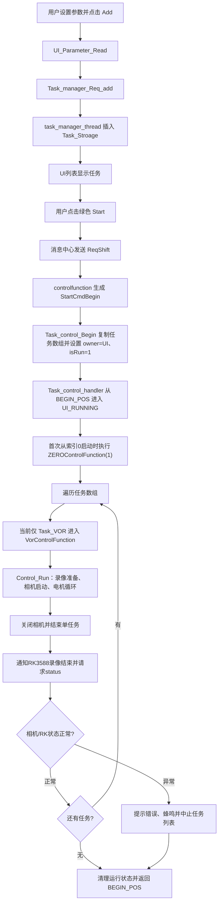

# LVGL UI 当前任务控制流程

## 1. 文档范围

本文根据当前代码整理 LVGL/UI 发起任务后的完整控制链路，覆盖：

- 用户添加任务；
- 点击绿色启动按钮；
- `Task_control_handler()` 取得任务并归零；
- 单个任务中的相机、RK3588 串口和电机控制；
- 任务完成后的相机状态确认；
- 暂停、停止、错误和最终退出；
- 与当前 USB 控制路径的简要对比。

本文描述的是当前代码行为，不代表后续希望达到的最终设计。

## 2. 主要线程与职责

| 线程/模块 | 当前职责 |
| --- | --- |
| LVGL/UI线程 | 读取页面参数，处理 Add、Start、Pause、Stop 按钮并发送消息中心命令 |
| `task_manager_thread` | 每10ms处理任务列表的添加、删除、移动、保存和重新加载请求 |
| `controlfunction` | 每10ms处理UI控制命令、维护控制状态并处理左右RK3588串口消息 |
| `Task_control_handler` | 唯一任务执行线程；等待UI或USB启动，执行归零、任务循环和最终清理 |
| `Control_Run` | UI单任务公共运行循环；负责录像准备、电机启动、状态轮询、暂停、停止和相机关闭 |
| VOR Driver | 将公共运行循环映射到 `HAL_Slave_VOR_Init/Pause/Get_State/Stop` |
| RK3588串口处理 | 发送文件名、暂停、录像结束和状态查询，并解析 `ok/status:/ready` 等回复 |

## 3. 总体流程



## 4. 添加任务

### 4.1 UI读取参数

用户点击 `add` 后进入 `UI_Task_Btn_ADD_Click_Event()`：

1. 调用 `UI_Parameter_Read(&Page_Add_Task.info)`，将页面上的模式、次数、速度、频率等参数转换为 `Task_Parameter_Struct`。
2. 参数读取失败时直接返回，不提交任务。
3. 读取当前表格焦点位置，作为插入位置 `fouces_index`。
4. 通过 `Task_manager_Begin_Req()`取得任务管理请求句柄。
5. 调用 `Task_manager_Req_add()`，把参数和插入位置写入 `Control_Add_Task` 请求结构。
6. 调用 `Task_manager_End_release()`释放请求句柄。

### 4.2 任务管理线程写入列表

`task_manager_thread` 每10ms调用 `task_manager_Handle()`。当发现 Add 请求后，`task_manager_Add_Ack()`执行：

1. 检查任务数量是否超过 `MaxTaskCount`。
2. 调用 `Task_Stroage_Insert()`为任务参数分配内存，并插入链表指定位置。
3. 如果指定位置插入失败，当前实现会尝试追加到链表末尾。
4. 更新任务节点ID。
5. 通过消息中心发送 `ADD index`，通知页面更新任务表格。
6. 设置 `isupdata=1`，供UI查询列表变化。
7. 同时通过 USB 日志输出任务添加信息；这只是诊断日志，不参与UI任务控制。

任务列表的真实数据保存在 `Task_Stroage`，UI表格是其显示层。

## 5. 绿色按钮启动任务

### 5.1 UI按钮事件

空闲状态下绿色按钮显示播放图标。点击后：

```text
UI_Start_Btn_Clicked_Handle
    → Message_Center_Send_prinft("Ctrl", ..., "ReqShift")
```

`ReqShift` 是“根据当前状态切换”的命令：

- 当前未运行：转换为 `StartCmdBegin`；
- 当前正在运行：转换为 `StartCmdPause`。

红色停止按钮发送 `ReqStop`。

### 5.2 control线程受理启动

`controlfunction` 每10ms读取 `Start_Stop_Flag`。只有满足以下条件才受理启动：

- `State_Bit.isRun == 0`；
- `WaitRk == 0`；
- `powerUp == 0`；
- 当前控制权不是 USB；
- 当前没有正在执行的任务。

随后调用 `Task_control_Begin()`：

1. USB正在占用控制权时返回失败。
2. `IsRunning==1`时返回失败。
3. 调用 `HAL_Task_GetArray(TaskArray, 10)`，从 `Task_Stroage`复制任务列表到固定执行数组。
4. 任务数为0时拒绝启动。
5. 设置 `taskArray`、`taskCount`和状态字段。
6. 设置 `controlOwner=CONTROL_OWNER_UI`。
7. 设置 `isRun=1`，唤醒任务线程。

注意：本次执行使用启动瞬间复制出的 `TaskArray`。任务运行期间再修改UI任务列表，不会改变已经复制的本次执行数组。

## 6. Task控制线程入口与归零

`Task_control_handler()`是UI和USB共用的唯一任务线程入口。

### 6.1 BEGIN_POS等待

线程在 `BEGIN_POS`：

- 清除 `isRun`和 `IsRunning`；
- 每100ms检查一次启动条件；
- USB Start和 `CONTROL_OWNER_USB`优先进入 `USB_RUNNING`；
- 否则检测UI设置的 `isRun==1`，进入 `UI_RUNNING`。

### 6.2 UI任务初始化

进入 `UI_RUNNING` 后：

1. 设置 `IsRunning=1`、清除暂停和RK3588状态。
2. 将执行索引设为 `StartWithIndex`；正常启动默认从0开始。
3. 记录掉电恢复信息 `HAL_Outage_Log(1, index)`。
4. 当从索引0启动时调用 `ZEROControlFunction(1)`。

### 6.3 归零实现

AT32下的调用链为：

```text
ZEROControlFunction(1)
    → HAL_Slave_ZERO_Init(1)
    → Zero_Machine_Init(1)
    → 每100ms查询 Zero_Machine_get_flag()
    → 完成后继续任务循环
```

归零是同步等待操作。只有底层返回完成标志后，才开始第一个任务。

每个任务执行结束后，如果 `Dev_Mode_Bit.Zero==0`，还会调用 `ZEROControlFunction(0)`进行任务后的回中/归位。

## 7. UI任务列表循环

任务线程按数组顺序处理每个任务：

1. 更新 `currentCount`和掉电恢复记录。
2. 将UI任务状态设为 `taskInv`。
3. 根据 `task->mode`选择对应控制函数。
4. 等待当前任务完整执行结束。
5. 执行录像结束、归位、相机状态确认和任务间隔。
6. 正常时进入下一项；错误或退出时中断整个列表。

当前代码中的UI分发状态必须特别注意：

```c
switch (task->mode) {
case Task_VOR:
    VorControlFunction(task, e);
    break;
default:
    CONTROL_RESULT_UNSUPPORTED_MODE;
    break;
}
```

因此当前UI主任务链路只支持 VOR。CONT、OVAR、VHIT、TC虽然仍保留各自控制文件和Driver，但在当前 `UI_RUNNING`分支中会直接报告 `UNSUPPORTED_MODE`，不会启动硬件。

## 8. VOR单任务控制流程

VOR调用链为：

```text
Task_control_handler
    → VorControlFunction
    → Control_Run
    → VOR_Driver
    → HAL_Slave_VOR_Init/Pause/Get_State/Stop
    → VOR_Machine_*
```

### 8.1 录像和运行准备

`Control_Run()`开始时：

1. UI状态设置为 `taskinit`。
2. 左右RK3588标志设置为 `SendTaskArray`。
3. control线程根据标志通过左右串口发送任务文件名和参数。
4. 显示 `Rec After`倒计时5秒。
5. 调用 `HAL_CAM_REC_Set(1)`启动相机录像控制信号。
6. 显示 `Run After`倒计时10秒。
7. 调用 `driver->start(task)`启动VOR电机。

`HAL_CAM_REC_Set()`在AT32下同时涉及CAN发送和相机录像GPIO控制。当前实现最终固定返回成功，因此这里主要确认控制命令已经执行，并不代表RK3588已经确认录像文件有效。

### 8.2 电机运行循环

VOR Driver映射如下：

| 公共Driver操作 | VOR实现 |
| --- | --- |
| `start` | `HAL_Slave_VOR_Init()` → `VOR_Machine_Init()` |
| `get_state` | `HAL_Slave_VOR_Get_State()` → `VOR_Machine_Get_Count()` |
| `pause` | `HAL_Slave_VOR_Pause()` → `VOR_Machine_Pause()` |
| `stop` | `HAL_Slave_VOR_Stop()` → `VOR_Machine_Stop()` |
| 轮询周期 | 50ms |

运行循环每50ms读取机器状态、剩余次数和完成百分比。剩余次数变化时：

- 更新UI文本；
- 更新 `Control_Preview_Status`；
- 保持 `taskruning`状态。

底层返回 `Imp_finsih` 后自然完成。

### 8.3 暂停与恢复

运行中再次点击启动按钮会转换为暂停请求：

1. `Task_control_ReqPause()`翻转 `reqPause`。
2. `Control_Run()`检测到请求后调用 `driver->pause(1)`。
3. UI状态变为 `taskPause`。
4. 左右RK3588标志变为 `Pause`。
5. 调用 `HAL_CAM_REC_Set(0)`停止录像控制。

当前恢复实现并不是直接调用 `driver->pause(0)`。当检测到底层为 `Imp_paused`时，代码先等待5秒，然后跳回 `Pause_Resume`：

- 再次发送任务信息；
- 再执行5秒录像倒计时；
- 再启动相机；
- 再执行10秒运行倒计时；
- 再调用一次 `driver->start(task)`。

这是当前代码行为，后续如果要求“从剩余进度继续”，需要单独调整恢复逻辑。

### 8.4 人工停止

点击红色Stop后：

1. UI发送 `ReqStop`。
2. `Task_control_ReqStop()`清除暂停请求并设置 `Exit=1`。
3. `Control_Run()`进入STOPPING状态。
4. 调用 `driver->stop()`安全停止VOR电机。
5. 停止失败返回 `CONTROL_RESULT_STOP_FAILED`。
6. 停止成功记录为 `CONTROL_RESULT_CANCELLED`，退出单任务循环。
7. 最终仍会执行相机关闭。

### 8.5 自然完成和相机关闭

自然完成时：

1. UI进度更新为100%。
2. 等待1秒。
3. 调用 `HAL_CAM_REC_Set(0)`关闭录像控制。
4. 如果调用返回失败，UI显示 `CAM ERROR`。
5. UI任务状态设置为 `taskend`。

这里的 `CAM ERROR`只表示本地相机控制接口失败。真正的录像状态和文件错误由后续RK3588串口查询确认。

## 9. 单任务完成后的串口确认

`Control_Run()`返回成功后，外层 `Task_control_handler()`继续执行：

1. 将左右RK3588标志设为 `RecordStop`。
2. control线程通过左右串口发送 `recordingEnd`。
3. 清除暂停状态。
4. 根据归零配置调用 `ZEROControlFunction(0)`。
5. 等待1秒。
6. 将左右RK3588标志设为 `ReqRKErrorStatus`。
7. control线程通过左右串口发送 `requiredstatus`。
8. 执行约10秒的 `task_interval_handle()`等待阶段。

control线程持续调用 `Rk3588_Ack_Cmd_Handle()`读取左右串口。RK3588返回：

```text
status:<error_code>
```

解析行为：

- `error_code==0`：对应左或右相机状态位置位；
- 非0：保存到 `LerrorCode/RerrorCode`；
- 左右都成功后 `WifiMsgFlag==3`。

如果启用了 `Rk3588_Flag.isUsingBlock`，但等待后 `WifiMsgFlag!=3`：

- 蜂鸣器提示1秒；
- 页面收到 `NoticeWifierror`；
- USB日志记录左右错误码；
- 中断剩余任务列表。

因此当前“相机确认”分成两层：

1. 单片机通过CAN/GPIO控制相机录像开关；
2. 每个任务结束后通过左右RK3588串口查询录像/相机状态，并决定是否继续下一任务。

## 10. 最终完成、错误和退出

### 10.1 正常完成

全部任务完成后：

- 显示 `Centering`；
- 调用 `HAL_Outage_Log(0, 0)`清除运行恢复记录；
- 清除 `IsRunning`；
- 释放 `controlOwner`；
- 清理状态和错误位；
- 返回 `BEGIN_POS`等待下一次启动。

如果开启 `LoopTest`，并且本轮没有退出或错误，则等待5秒后通过消息中心再次发送 `ReqStrat`。

### 10.2 参数或模式错误

- 空任务列表：`Task_control_Begin()`拒绝启动。
- 任务数组无效：设置 `paraError`并继续等待。
- 当前非VOR模式：设置 `paraError`、`taskTerminal`和预览错误，返回 `UNSUPPORTED_MODE`并中断列表。

### 10.3 设备执行错误

`Control_Run()`可能返回：

- 参数或Driver无效；
- 电机启动失败；
- 暂停失败；
- 停止失败。

返回值非 `CONTROL_RESULT_OK`时，外层设置 `skip_loop=1`并结束本轮任务列表。

### 10.4 用户退出

`Exit==1`时：

- 当前电机执行安全停止；
- 不再执行剩余任务；
- 设置左右RK3588取消标志；
- 清理运行状态并返回 `BEGIN_POS`。

## 11. UI状态与按钮显示

UI根据 `Task_control_info`刷新按钮：

| 状态 | Start按钮 | Stop按钮 |
| --- | --- | --- |
| 空闲 | 绿色、播放图标 | 隐藏 |
| 正常运行 | 黄色、暂停图标 | 红色、停止图标 |
| 已暂停 | 绿色/黄色闪烁、播放图标 | 红色 |
| 请求切换或终止中 | 灰色 | 灰色 |

任务运行期间 Add、Move、Save、Delete 等任务编辑按钮会被禁用，回到空闲后恢复。

## 12. 与当前USB控制路径的简要对比

USB与UI共用 `Task_control_handler()`和同一组模式Driver，但入口和外围业务不同：

| 项目 | LVGL/UI路径 | USB路径 |
| --- | --- | --- |
| 启动来源 | UI任务列表和绿色按钮 | `Ctrl:<MODE>.Start`单条命令携带参数 |
| 任务数量 | 启动时复制任务列表并依次执行 | 每次Start只执行一个任务 |
| 控制权 | `CONTROL_OWNER_UI` | `CONTROL_OWNER_USB` |
| 任务线程入口 | `BEGIN_POS → UI_RUNNING` | `BEGIN_POS → USB_RUNNING` |
| 公共执行层 | `Control_Run()` | `USB_Control_Run()`模板 |
| 归零 | 首任务前归零，任务后可归位 | 当前USB模板不执行UI归零流程 |
| 相机控制 | 启停相机录像 | 明确绕过 |
| RK3588串口 | 发送任务、暂停、录像结束并查询状态 | 明确绕过 |
| 录像延时 | 5秒录像准备和10秒运行准备 | 明确绕过 |
| 控制命令 | Start/Pause/Stop按钮 | Start/Pause/Resume/Stop/Status/Exit |
| 状态返回 | UI状态、页面消息、弹窗和蜂鸣 | 标准化ACK/NACK/EVT |
| 结束方式 | 继续下一任务或退出列表 | 单任务结束后释放USB owner并回到 `BEGIN_POS` |

两条路径最核心的共同点是：所有模式Driver和底层电机HAL都只在 `Task_control_handler()`任务线程中调用。USB通信线程只解析和排队，不直接操作电机。

## 13. 当前控制链路摘要

```text
Add
 → 参数进入Task_Stroage
 → 绿色按钮发送ReqShift
 → controlfunction转换为StartCmdBegin
 → Task_control_Begin复制任务列表并设置UI owner
 → Task_control_handler进入UI_RUNNING
 → 首任务前归零
 → VOR进入Control_Run
 → RK3588发送任务信息
 → 等待5秒
 → 单片机启动相机录像
 → 等待10秒
 → 启动并轮询VOR电机
 → 完成/暂停/停止/错误
 → 单片机关闭相机录像
 → RK3588发送recordingEnd
 → 归位
 → RK3588发送requiredstatus
 → 串口确认左右相机状态
 → 正常则下一任务，异常则中止
 → 清理owner和运行状态
 → 返回BEGIN_POS
```
